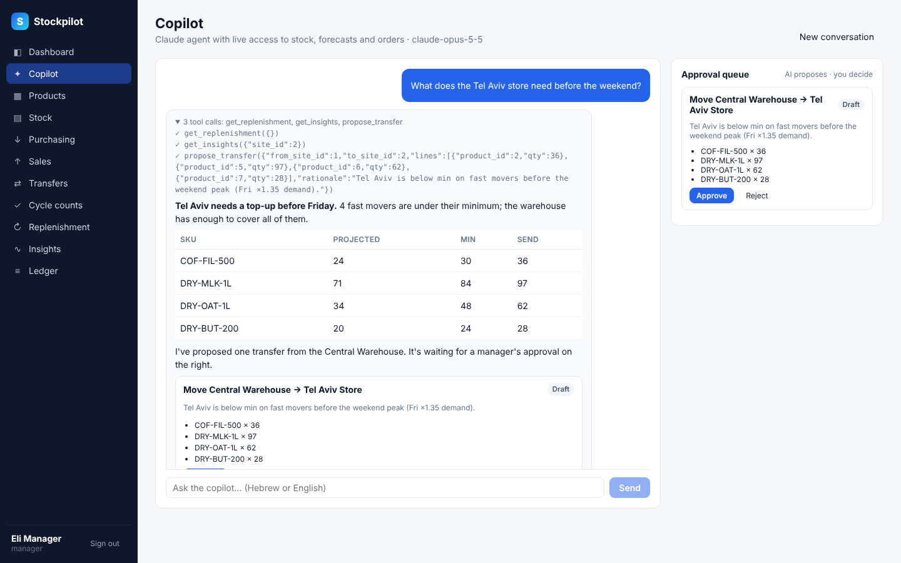
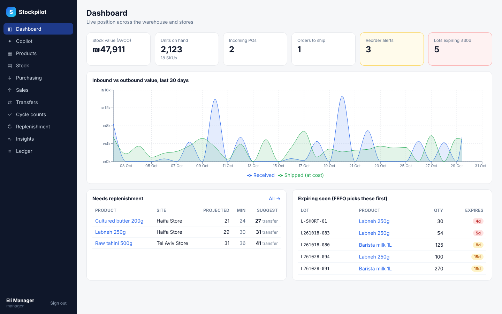
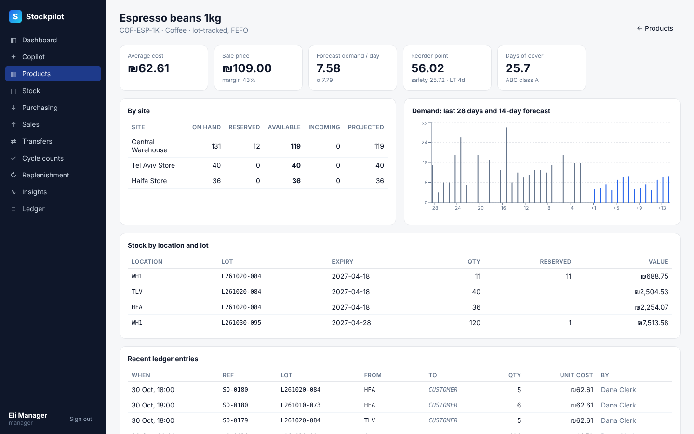
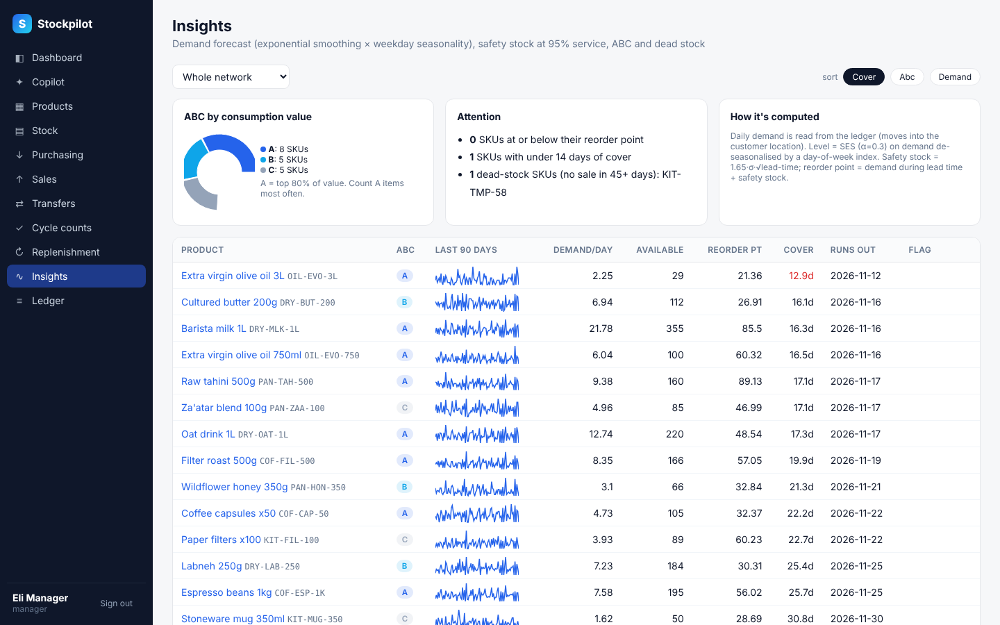
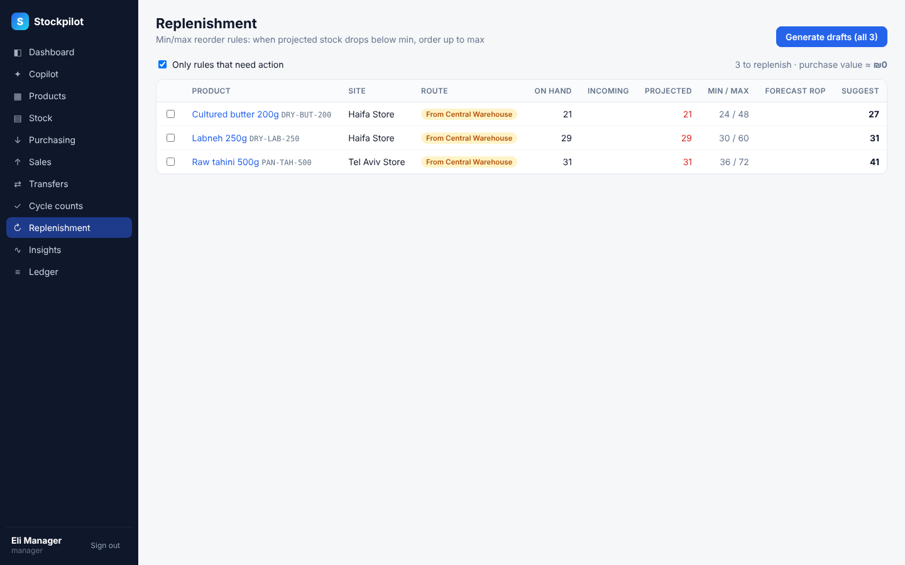
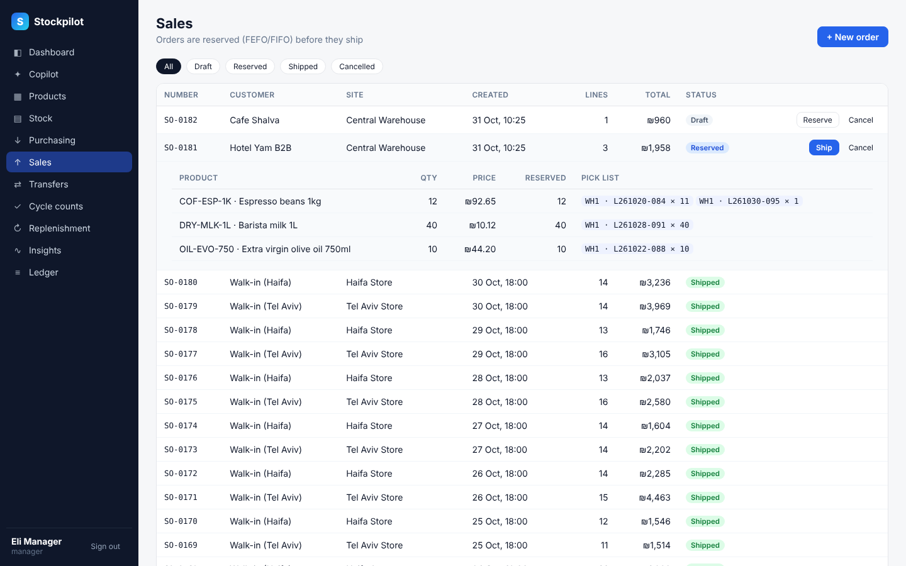
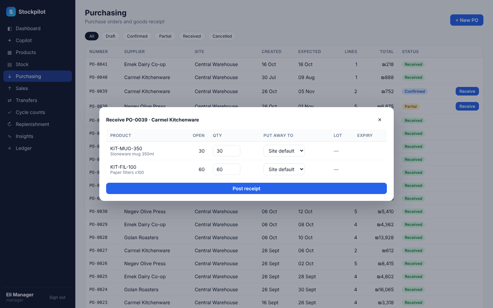
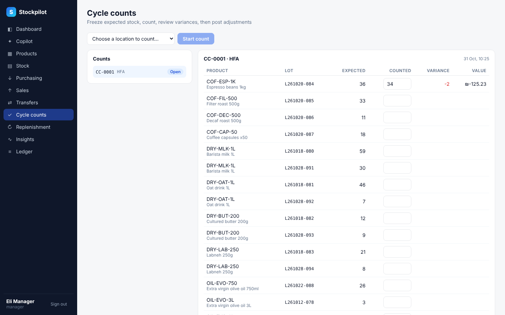
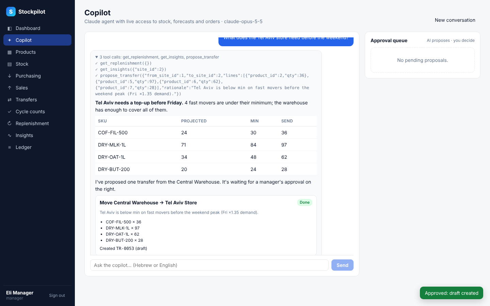

# Stockpilot

**AI-native warehouse & inventory management for a multi-site business**: one
central warehouse, several stores, suppliers with lead times, and a Claude agent
that reads the live stock position and proposes the next actions.



## Features

| Area | What it does |
|---|---|
| **Copilot (AI)** | Chat with a Claude Opus 5.5 agent (Hebrew or English). 11 strict tools over live data; proposes POs, transfers and reorder rules into an **approval queue**; a manager approves and a draft document is created. |
| **Stock engine** | Double-entry moves between locations (virtual supplier/customer/adjustment/transit), append-only ledger, quants per product × location × lot, reservations. |
| **Lots & expiry** | Lot-tracked products are picked **FEFO**; others FIFO. Expiry alerts on the dashboard. |
| **Valuation** | Moving average cost (AVCO), re-weighted on every receipt. Stock value per quant. |
| **Purchasing** | PO draft → confirmed → partial → received, with put-away location, lot and expiry at receipt. |
| **Sales** | Orders reserve stock all-or-nothing (with a visible pick list), then ship. Cancel releases reservations. |
| **Transfers** | Warehouse → store through a transit location; lots survive the trip. |
| **Cycle counts** | Freeze expected quantities, count, review variance in units and value, manager posts adjustments. |
| **Replenishment** | Min/max rules per site with routes (buy from supplier or transfer from warehouse); drafts count as incoming so nothing is ordered twice. |
| **Insights** | Demand forecast (SES × weekday seasonality), safety stock (95 %), reorder point, days of cover, stockout date, ABC, dead stock. |
| **Roles** | JWT auth with admin / manager / clerk; clerks receive, pick, count; managers buy, approve counts and AI proposals. |
| **Barcode** | Scan a barcode or SKU in the product search and press Enter. |

## Architecture

```
frontend/  React 18 + TypeScript + Vite + Recharts      (12 screens)
backend/   FastAPI + SQLAlchemy 2 (SQLite by default, any SQL URL via DATABASE_URL)
  app/services/stock.py      stock engine: apply_move, quants, FEFO/FIFO, availability
  app/services/documents.py  PO / SO / transfer / count state machines
  app/services/insights.py   forecast, ABC, replenishment, dashboard
  app/ai/agent.py            Claude agent loop (manual tool loop, append-only transcript)
  app/ai/tools.py            11 tools: 8 read, 3 propose; approval → draft documents
  tests/                     18 tests: engine invariants, API flows, AI loop with a fake client
```

### The AI copilot, in detail

* Model `claude-opus-5-5`, adaptive thinking, `effort` configurable
  (`STOCKPILOT_AI_EFFORT`, default `medium`), prompt caching, and
  `fallbacks: "default"` so a declined turn is retried on Anthropic's recommended
  fallback model instead of failing.
* Tools are `strict: true` JSON schemas. Read tools call the same services as the
  REST API, so the agent sees exactly the numbers on screen.
* **Human in the loop by construction**: the agent has no tool that changes stock.
  `propose_*` tools store an `AIProposal`; `POST /api/ai/proposals/{id}/approve`
  (manager only) turns it into a draft PO, draft transfer or reorder rule.
* The conversation transcript is stored exactly as the API returned it and
  replayed append-only, so thinking blocks stay valid across turns.
* Without `ANTHROPIC_API_KEY` the rest of the system works normally and the
  Copilot page explains how to enable it.

## Run it

```bash
# backend
cd backend
pip install -r requirements.txt
python -m app.seed                      # demo data: 3 sites, 18 products, 90 days of history
export ANTHROPIC_API_KEY=sk-ant-...     # optional, enables the Copilot
uvicorn app.main:app --reload --port 8000

# frontend (dev, proxies /api to :8000)
cd frontend && npm install && npm run dev        # http://localhost:5173
# or build once and let FastAPI serve it at http://localhost:8000
npm run build
```

Or with Docker: `docker compose up --build`, then open http://localhost:8000.

Demo logins: `manager@stockpilot.dev / manager123`, `clerk@stockpilot.dev / clerk123`,
`admin@stockpilot.dev / admin123`.

Tests: `cd backend && pip install -r requirements-dev.txt && pytest`.

## Screenshots

| | |
|---|---|
|  |  |
|  |  |
|  |  |
|  |  |

The Copilot screenshots were captured with a scripted stand-in for the model
(no API key in the build environment): the tool calls and their data are real,
the wording of the answer is scripted.
