# Stockpilot

[](https://github.com/mckova/stockpilot/actions/workflows/ci.yml)

**Stock for one warehouse and the stores it feeds, with an AI planner that asks
before it acts.** A central warehouse, two stores, suppliers with lead times,
and Claude reading the live stock position every morning: it proposes orders
and transfers, a manager signs, and only then does anything move.

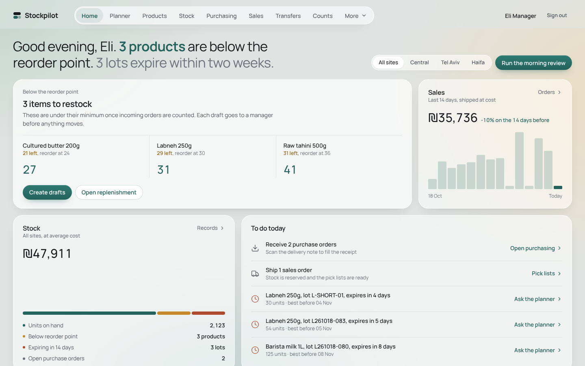

## What it does

| Area | What it does |
|---|---|
| **Planner (AI)** | A Claude Opus 5.5 agent with 11 strict tools over live data. Runs the morning review on demand or answers questions in Hebrew or English. Its only write tools are *propose* tools: orders, transfers and rule changes land on a sign-off queue, and a manager's approval creates the draft document. |
| **Delivery-note intake (AI)** | Upload a photo or PDF of a supplier's delivery note while receiving a PO. Claude reads it with vision into a strict JSON schema; the receipt form is pre-filled with quantities, lots and expiry dates, and differences are flagged: over-delivery, price changes, missing lines, a note from a different supplier than the PO. Nothing posts until a person does. |
| **Home** | A worklist, not a dashboard: proposals waiting for sign-off, items below their minimum (with a one-click draft), lots expiring in the next two weeks, orders to ship. Each row carries its own action. |
| **Point of sale** | Store till with barcode scan; every sale is a ledger move from the store shelf, oldest expiry first. |
| **Stock engine** | Double-entry moves between locations (virtual supplier, customer, adjustment and transit), append-only ledger, quants per product × location × lot, reservations. |
| **Lots & expiry** | Lot-tracked products are picked **FEFO**, others FIFO. |
| **Valuation** | Moving average cost, re-weighted on every receipt. |
| **Purchasing, sales, transfers, counts** | Full state machines: PO draft → confirmed → partial → received; orders reserve all-or-nothing and then ship; transfers go through transit with lots intact; counts freeze expected quantities and post variances. |
| **Replenishment** | Min/max rules per site with a route (buy from a supplier or move from the warehouse). Drafts count as incoming so nothing is ordered twice. |
| **Demand** | Forecast (SES with a weekday index), safety stock at 95 %, reorder point, days of cover, stockout date, ABC and dead stock. |
| **Roles** | JWT auth: admin, manager, clerk. Clerks receive, sell, pick and count; managers buy and sign off. |

## Design

Frosted panels on a soft sage and sand field, one pine green for actions, plain
tables for the work, and a pill nav. Status is a word with a dot; amber and red
appear only as data (below minimum, expiring, waiting for sign-off). Manrope
throughout. Details and rules are in [DESIGN.md](DESIGN.md).

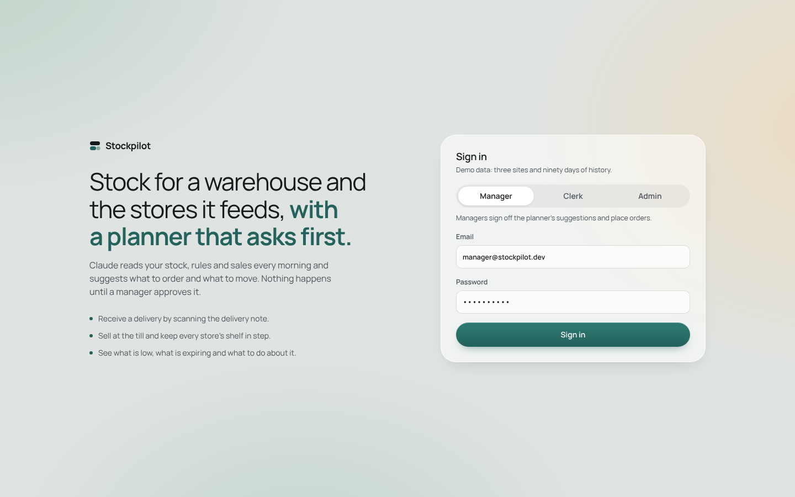

## Architecture

```
frontend/  React 18 + TypeScript + Vite + Recharts      (14 screens)
backend/   FastAPI + SQLAlchemy 2 (SQLite by default, any SQL URL via DATABASE_URL)
  app/services/stock.py      stock engine: apply_move, quants, FEFO/FIFO, availability
  app/services/documents.py  PO / SO / transfer / count state machines
  app/services/insights.py   forecast, ABC, replenishment, dashboard
  app/ai/agent.py            Claude agent loop and the morning planner
  app/ai/tools.py            11 tools: 8 read, 3 propose; approval → draft documents
  app/ai/intake.py           delivery note → structured output → matched to the PO
  tests/                     22 tests: engine invariants, API flows, AI with a fake client
```

### The AI layer, in detail

* Model `claude-opus-5-5` with adaptive thinking and a configurable effort
  (`STOCKPILOT_AI_EFFORT`, default `medium`), prompt caching, and server-side
  fallbacks so a declined turn is retried on the recommended fallback model
  instead of failing.
* Tools are `strict: true` JSON schemas. Read tools call the same services as the
  REST API, so the planner sees exactly the numbers on screen.
* **Human in the loop by construction.** The agent has no tool that changes
  stock. `propose_*` tools store a proposal; `POST /api/ai/proposals/{id}/approve`
  (manager only) turns it into a draft PO, draft transfer or reorder rule.
* Intake uses structured outputs (`json_schema`) with image or PDF input, then
  deterministic matching against the open PO; every mismatch becomes a warning
  on the form instead of a silent correction.
* Transcripts are stored exactly as the API returned them and replayed
  append-only, so thinking blocks stay valid across turns.
* Without `ANTHROPIC_API_KEY` everything else works, and the AI screens say how
  to enable it.

## Run it

```bash
# backend
cd backend
pip install -r requirements.txt
python -m app.seed                      # demo data: 3 sites, 18 products, 90 days of history
export ANTHROPIC_API_KEY=sk-ant-...     # optional, enables the planner and intake
uvicorn app.main:app --reload --port 8000

# frontend (dev, proxies /api to :8000)
cd frontend && npm install && npm run dev        # http://localhost:5173
# or build once and let FastAPI serve it at http://localhost:8000
npm run build
```

Or with Docker: `docker compose up --build`, then open http://localhost:8000.

Demo logins: `manager@stockpilot.dev / manager123`, `clerk@stockpilot.dev / clerk123`,
`admin@stockpilot.dev / admin123`.

Tests: `cd backend && pip install -r requirements-dev.txt && pytest`. CI runs the
backend tests and a type-checked frontend build on every push.

## Screenshots

| | |
|---|---|
| 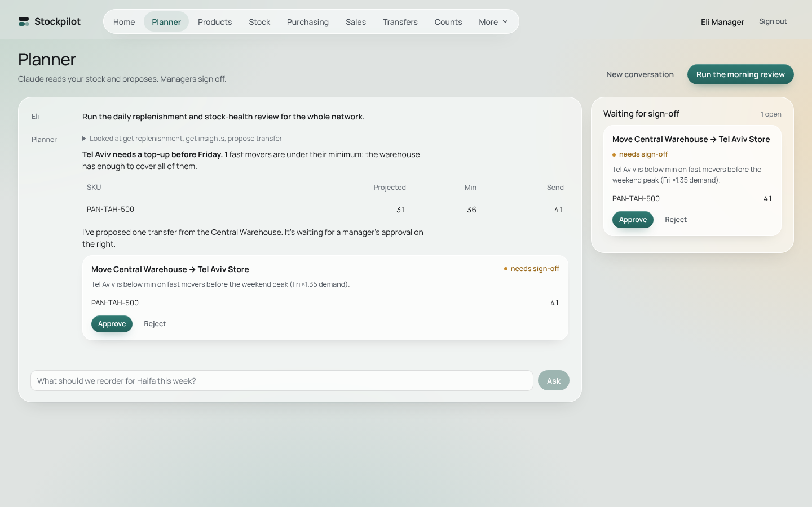 | 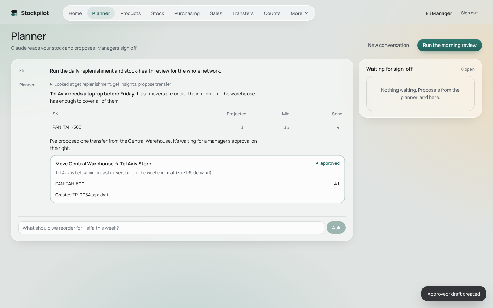 |
| 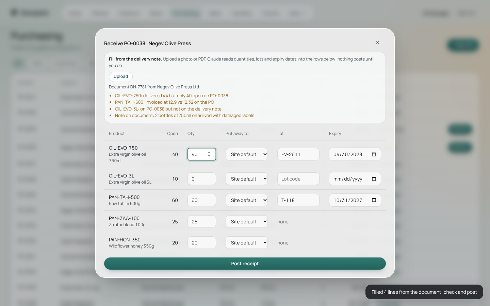 | 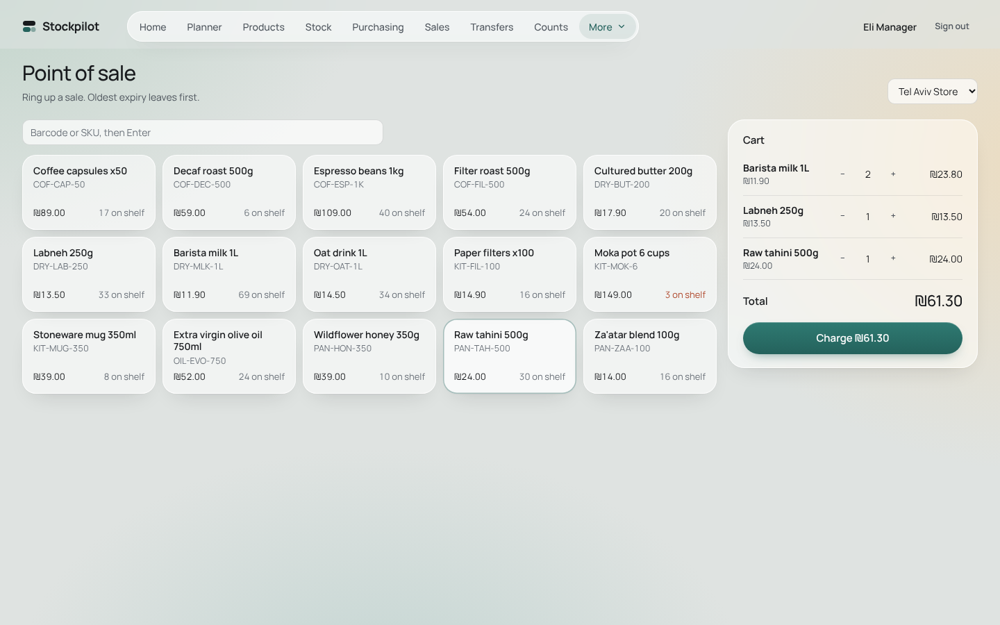 |
| 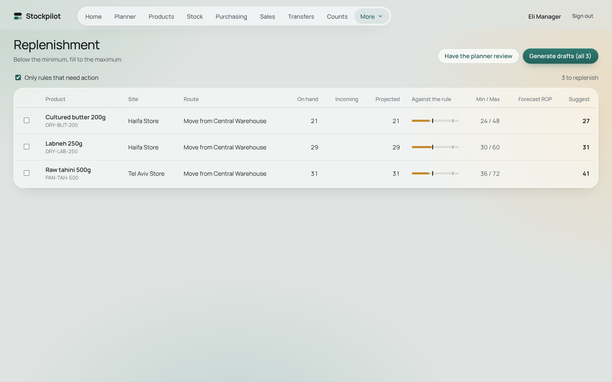 | 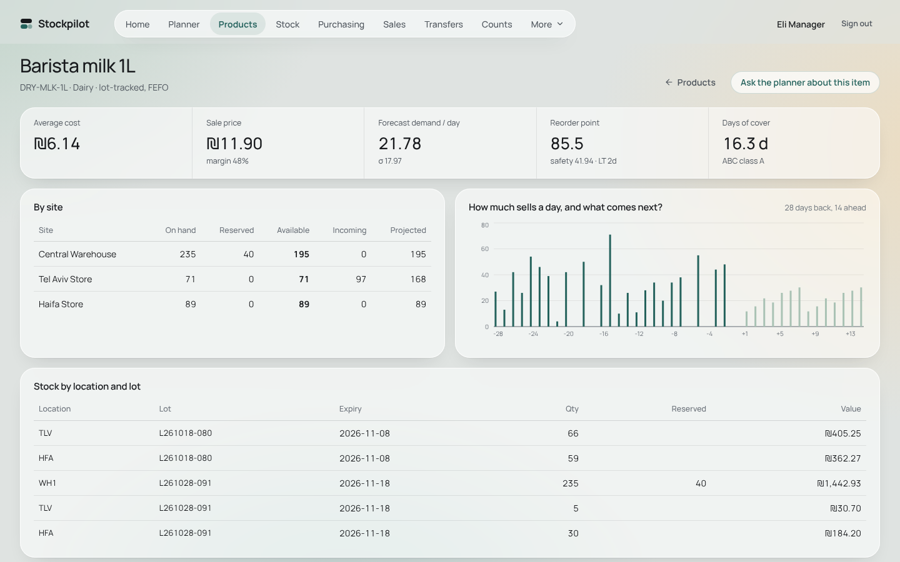 |
| 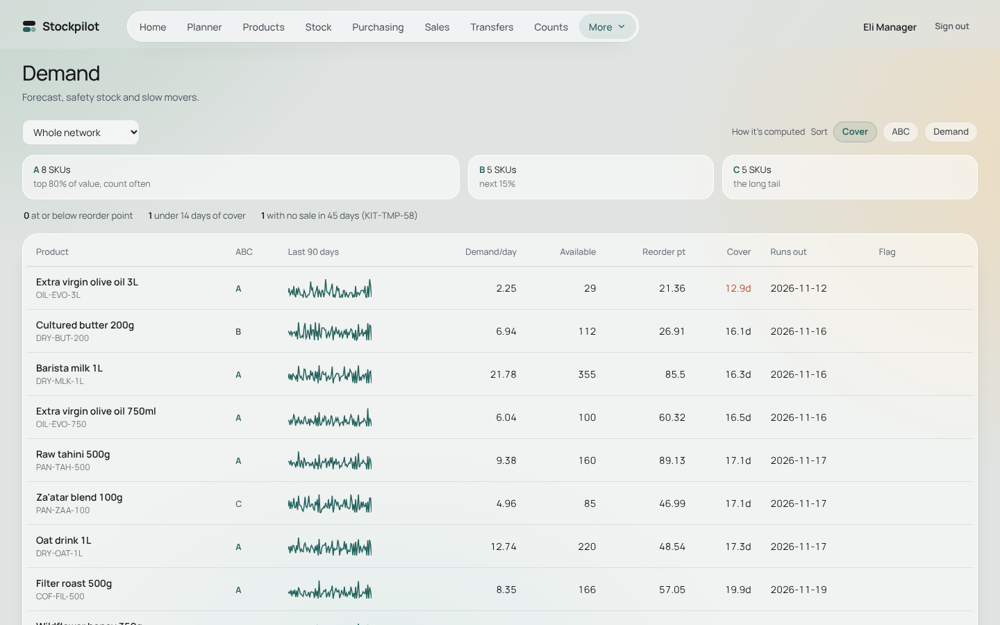 | 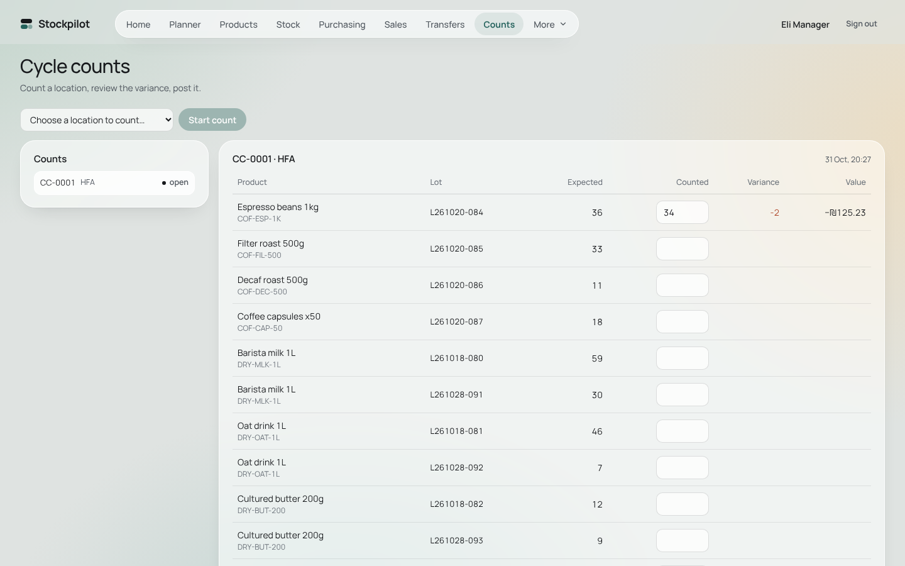 |

On a phone: 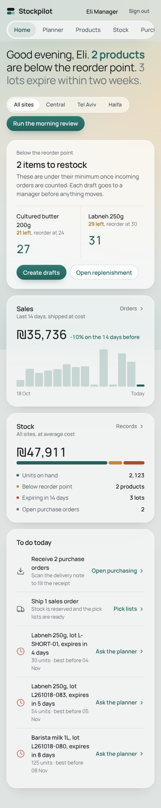

The planner and intake screenshots were captured with a scripted stand-in for
the model (no API key in the build environment): the tool calls, the data and the
PO matching are real; the wording of the answers and the extracted note are
scripted.
